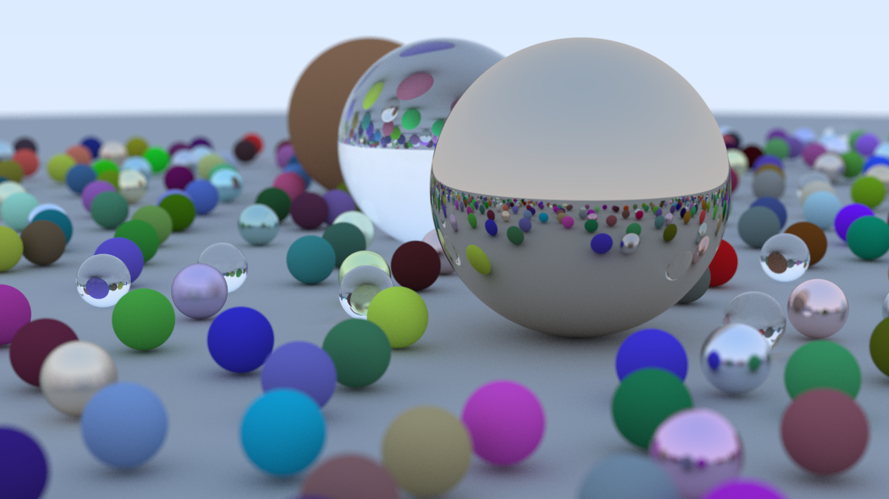
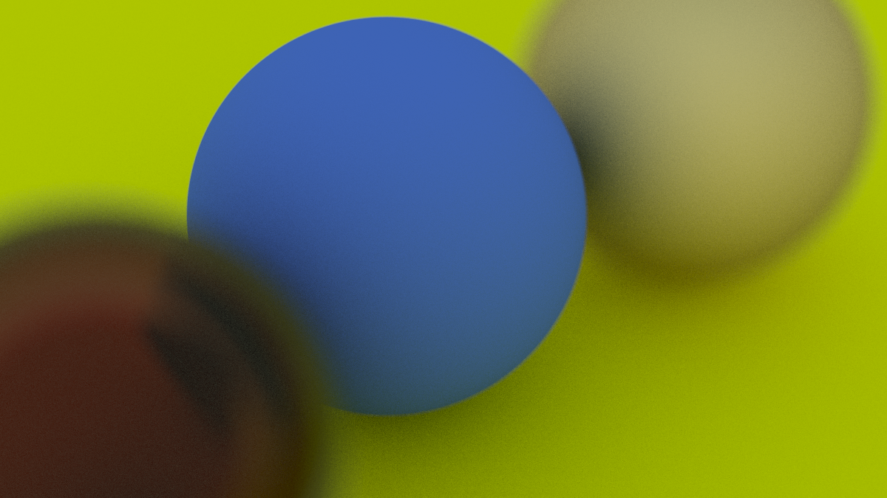
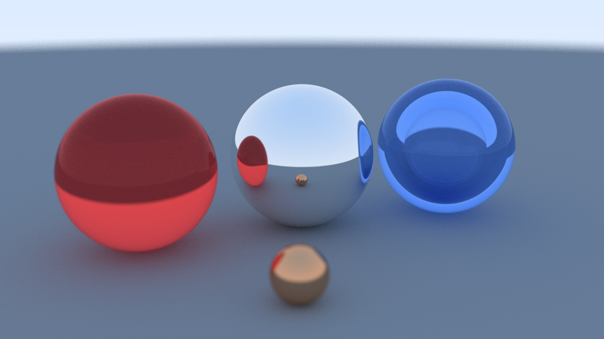

# Ray Tracing in a Weekend

A C++ ray tracer, written while following [Ray Tracing in One Weekend](https://raytracing.github.io/books/RayTracingInOneWeekend.html) by Peter Shirley, Trevor David Black, and Steve Hollasch.



## Features

- Spheres
- Matte, fuzzy metal, and tinted glass
- Hollow glass, from a bubble with the inverse refraction index
- A camera you can place and aim, with field of view and defocus blur
- Antialiasing from many rays per pixel





## Run

```
python render.py release
```

CMake fetches GLM, builds the tracer, and writes `image.png`. The scene is in `src/main.cc`.
